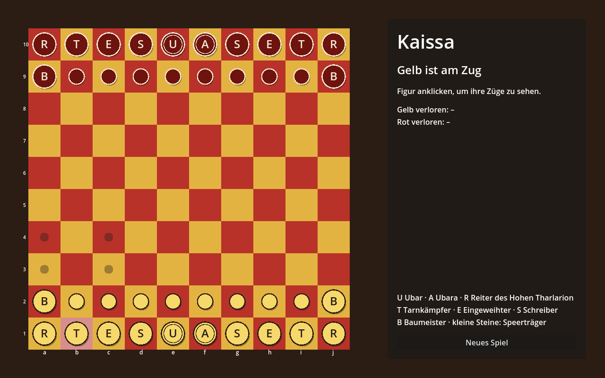

# Kaissa

Ein Brettspiel in **Godot 4**, inspiriert vom Spiel *Kaissa* aus der Gor-Saga von John Norman.
Zwei Parteien, **Rot** und **Gelb**, treten auf einem Brett mit 10 × 10 Feldern gegeneinander an.



> Dies ist ein Fanprojekt. Code und Grafik sind eigenständig erstellt. Die Romane beschreiben
> Kaissa nur in Andeutungen, deshalb sind viele Regeln hier eigene Festlegungen. Sie stehen in
> [docs/regeln.md](docs/regeln.md).

## Stand

- 10 × 10-Brett mit roten und gelben Feldern, Koordinaten a–j / 1–10
- Je Seite 20 Figuren: Ubar, Ubara, Reiter des Hohen Tharlarion, Tarnkämpfer, Eingeweihte,
  Schreiber, Baumeister und Speerträger
- Zwei Spieler an einem Rechner (Hot-Seat): Figur anklicken, erlaubte Zielfelder werden markiert
- Schlagen, Zugwechsel, Sieg durch Schlagen des gegnerischen Ubar
- Die Figuren werden derzeit per Code gezeichnet (Kreise mit Buchstaben), es gibt noch keine Grafiken

## Starten

1. [Godot 4.3](https://godotengine.org/download) oder neuer installieren (Standardversion, kein .NET nötig).
2. Godot öffnen, **Importieren** wählen und die Datei `project.godot` aus diesem Ordner auswählen.
3. Mit **F5** starten.

Bedienung: Linksklick wählt eine eigene Figur und zieht sie, Rechtsklick hebt die Auswahl auf.

## Aufbau

```
project.godot          Projekteinstellungen (Hauptszene, Fenstergröße, Renderer)
scenes/
  main.tscn            Hauptszene mit Brett und Seitenleiste
  board.tscn           Das Spielbrett
scripts/
  piece_types.gd       Figurentypen, Zugmuster und Grundaufstellung (hier Regeln anpassen)
  kaissa_rules.gd      Spielzustand und Zuglogik, unabhängig von der Darstellung
  board_view.gd        Zeichnet Brett und Figuren, verarbeitet Mausklicks
  main.gd              Verbindet Regeln, Brett und Oberfläche
assets/                Platz für Grafiken, Schriften und Klänge
docs/regeln.md         Die Spielregeln dieses Projekts
```

## Ideen für die nächsten Schritte

- Eigene Grafiken für die Figuren
- Heimstein als Spielelement (siehe Regeln)
- Computergegner
- Spielstand speichern und Zugliste in Notation
- Netzwerkspiel
