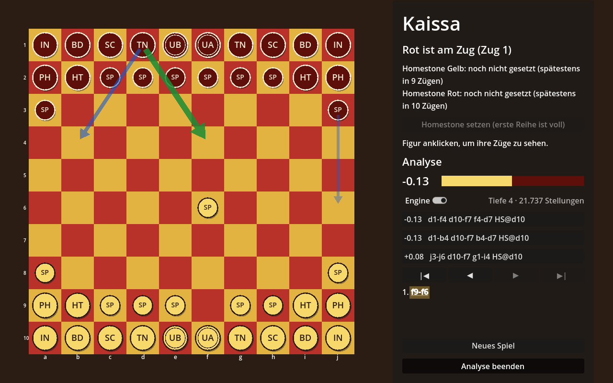

# Kaissa

Ein Brettspiel in **Godot 4**, inspiriert vom Spiel *Kaissa* aus der Gor-Saga von John Norman.
Zwei Parteien, **Rot** und **Gelb**, treten auf einem Brett mit 10 × 10 Feldern gegeneinander an.


> Dies ist ein Fanprojekt. Code und Grafik sind eigenständig erstellt. Die Regeln stehen in
> [docs/regeln.md](docs/regeln.md).

## Stand

- 10 × 10-Brett mit roten und gelben Feldern, Koordinaten a–j / 1–10
- Je Seite 22 Figuren: Ubar, Ubara, Tarnsmen, Scribes, Builders, Initiates, Spearmen,
  Riders of the High Tharlarion und Physicians, dazu der Homestone
- Zwei Spieler an einem Rechner (Hot-Seat): Figur anklicken, erlaubte Zielfelder werden markiert
- Computergegner in vier Stufen (leicht, mittel, schwer, Meister), für jede Seite getrennt wählbar
- Homestone setzen (spätestens im zehnten Zug), Sieg durch Schlagen des gegnerischen Homestone
- Spearmen werden auf der gegnerischen ersten Reihe gegen Rider oder Tarnsman eingelöst
- Aufgeben und Remis
- Analysemodus wie bei Lichess: die Engine zeigt laufend die drei besten Züge mit Bewertung
- Die Figuren werden derzeit per Code gezeichnet (Kreise mit Kürzel, Homestone als Raute)

## Starten

1. [Godot 4.3](https://godotengine.org/download) oder neuer installieren (Standardversion, kein .NET nötig).
2. Godot öffnen, **Importieren** wählen und die Datei `project.godot` aus diesem Ordner auswählen.
3. Mit **F5** starten.

Bedienung: Linksklick wählt eine eigene Figur und zieht sie, Rechtsklick hebt die Auswahl auf.
Mit „Homestone setzen“ in der Seitenleiste werden die freien Felder der ersten Reihe markiert.

### Computergegner

Oben in der Seitenleiste wird für Gelb und Rot jeweils „Mensch“ oder ein Bot gewählt.
Voreingestellt spielt man selbst Gelb gegen „Bot (mittel)“ als Rot. Die Auswahl gilt sofort,
auch mitten im Spiel. Stehen beide Seiten auf Bot, spielt der Computer gegen sich selbst.

| Stufe | Spielweise |
|---|---|
| leicht | schaut nur einen Zug weit und entscheidet mit viel Zufall, übersieht also oft Drohungen |
| mittel | rechnet die Antwort des Gegners mit ein |
| schwer | rechnet bis zu vier Halbzüge voraus und Schlagabfolgen zu Ende, denkt bis zu vier Sekunden |
| Meister | Engine nach dem Vorbild von Schach-Engines wie Stockfish: Transpositionstabelle, Principal Variation Search, Null-Zug-Suche, Late Move Reductions und History-Heuristik. Rechnet in acht Sekunden meist fünf bis sechs Halbzüge tief |

Ein Remisangebot nimmt der Bot nur an, wenn er nicht klar vorn liegt. „Aufgeben“ gibt immer
für den menschlichen Spieler auf.

Ab Stufe mittel spielen die Bots die ersten Züge aus einem Eröffnungsbuch
(`scripts/opening_book.gd`), das aus Bot-gegen-Bot-Partien gewonnen wurde. Steht eine Stellung
nicht im Buch, rechnen sie wie gewohnt. Die Auswertung steht in
[docs/eroeffnungen.md](docs/eroeffnungen.md).

### Analysemodus

Der Knopf **„Analysemodus“** unten in der Seitenleiste schaltet in die Analyse, ähnlich wie bei
Lichess. Die Bots pausieren, man zieht für beide Seiten selbst, und die Engine (Suche der Stufe
Meister) rechnet die Stellung auf dem Brett laufend durch:

- **Bewertung** aus Sicht von Gelb in Spearmen: `+1.20` heißt, Gelb steht etwa einen Spearman
  besser, `-0.50` ist gut für Rot. `#3` bedeutet, dass Gelb den Homestone in drei eigenen Zügen
  erzwingt, `#-3` dasselbe für Rot. Der Balken zeigt das Verhältnis (gelb links, rot rechts).
- **Die drei besten Züge** mit ihrer Hauptvariante; ein Klick spielt den Zug. Auf dem Brett zeigt
  ein grüner Pfeil den besten Zug, blaue Pfeile die beiden nächsten. Darüber stehen Rechentiefe
  und Anzahl der Stellungen; die Engine rechnet mit jeder Tiefe weiter, höchstens eine Minute je
  Stellung. Mit dem Schalter „Engine“ lässt sie sich abschalten.
- **Zugliste** mit allen Zügen der Partie. Ein Klick auf einen Zug oder die Knöpfe |◀ ◀ ▶ ▶|
  (auch Pfeiltasten, Pos1 und Ende) springen zu dieser Stellung. Zieht man dort anders, beginnt
  eine neue Variante.

Die laufende Partie wird beim Einschalten übernommen. „Analyse beenden“ setzt die Partie von der
gerade angezeigten Stellung aus fort, mit den eingestellten Spielern.



### Eröffnungen mit Bot-Partien testen

`tools/bot_match.gd` lässt Bots ohne Fenster gegeneinander spielen, `tools/analyze_openings.py`
wertet die Partien aus und erzeugt Bericht und Eröffnungsbuch:

```sh
# 50 Partien schwer gegen schwer, 200 ms je Zug, erster Zug von Gelb zufällig
godot --headless --path . -s tools/bot_match.gd -- --games 50 --time 200 --random-plies 1 --out runs/partien.jsonl
# Partien ab einer festen Eröffnung, die ersten 10 Halbzüge mit etwas Zufall
godot --headless --path . -s tools/bot_match.gd -- --games 20 --opening "g10-i7 f2-f3" --random-plies 0 --noise-plies 10 --out runs/partien.jsonl
# Analyse wie im Analysemodus: die drei besten Züge nach einer Zugfolge, 10 s lang
godot --headless --path . -s tools/bot_match.gd -- --mode analyze --time 10000 --opening "g10-i7"
# Engine (Meister, 3 s) bewertet jeden möglichen Zug nach einer Zugfolge
godot --headless --path . -s tools/bot_match.gd -- --mode rank --yellow master --time 3000 --opening "g10-i7" --out runs/bewertung.jsonl
# Baum automatisch ausbauen: jede über Buchzüge erreichte Stellung bewerten, bis 5 Halbzüge tief
python3 tools/expand_book.py --godot godot --rank runs/bewertung.jsonl --games runs/partien.jsonl --depth 5 --jobs 4
# Auswerten, Bericht und Buch neu schreiben, Buch prüfen
python3 tools/analyze_openings.py --games runs/partien.jsonl --rank runs/bewertung.jsonl --report docs/eroeffnungen.md --book scripts/opening_book.gd
godot --headless --path . -s tools/bot_match.gd -- --mode checkbook
```

Züge werden als `e9-e7` (ziehen), `d10xg7` (schlagen), `c2-c1=TN` (einlösen) und `HS@c10`
(Homestone setzen) geschrieben. Jede Partie läuft in einem eigenen Prozess; mehrere Prozesse
parallel nutzen mehrere Prozessorkerne. Hat eine Seite über zehn Halbzüge mehr als 15 Spearmen
Vorsprung, wird die Partie für sie gewertet; nach 200 Halbzügen endet sie remis.

## Aufbau

```
project.godot          Projekteinstellungen (Hauptszene, Fenstergröße, Renderer)
scenes/
  main.tscn            Hauptszene mit Brett und Seitenleiste
  board.tscn           Das Spielbrett
scripts/
  piece_types.gd       Figurentypen, Zugmuster und Grundaufstellung (hier Regeln anpassen)
  kaissa_rules.gd      Spielzustand und Zuglogik, unabhängig von der Darstellung
  kaissa_ai.gd         Computergegner (Alpha-Beta- und Engine-Suche, Stellungsbewertung, Stufen)
  opening_book.gd      Eröffnungsbuch der Bots (erzeugt aus Bot-Partien)
  board_view.gd        Zeichnet Brett und Figuren, verarbeitet Mausklicks
  analysis_panel.gd    Analysemodus: Engine im Hintergrund, beste Züge, Zugliste
  main.gd              Verbindet Regeln, Brett und Oberfläche
assets/                Platz für Grafiken, Schriften und Klänge
docs/regeln.md         Die Spielregeln dieses Projekts
docs/eroeffnungen.md   Auswertung der Bot-gegen-Bot-Partien
tools/                 Bot-Turniere ohne Fenster und ihre Auswertung
```

## Ideen für die nächsten Schritte

- Eigene Grafiken für die Figuren
- Spielstand speichern
- Netzwerkspiel
